# Xena Studios — Brand


The Xena Studios identity, and the identities of everything Xena makes. Every file here is generated from code by [`scripts/build.mjs`](scripts/build.mjs).

- [Architecture](#architecture)
- **Xena Studios**: [Logo](#logo) · [Colour](#colour) · [Typography](#typography) · [Horizon](#horizon) · [People](#people) · [Google Workspace](#google-workspace)
- **Products**: [Raptor](#raptor) · [NeoSkript](#neoskript)
- **Plugin family**: [Plugins](#plugins)
- [Where each file goes](#where-each-file-goes) · [Build](#build)

## Architecture

Three tiers. Each keeps its own look, and Xena ties them together with the same two things: the **XENA STUDIOS** endorsement and the planet **horizon**.

| Tier | Members | Identity |
|---|---|---|
| **Studio** | Xena Studios | Type only, Ion Blue on deep space. |
| **Products** | Raptor, NeoSkript | A full brand each (mark, colour, type), endorsed by XENA STUDIOS. For platforms with their own docs, community and roadmap. |
| **Plugin family** | xUtilities, zChat, xLimbo, and future small plugins | One shared system, with a pixel glyph and an accent per plugin. For small, single-purpose plugins. |

Every brand gets its own accent, and no two share one: Ion Blue (Xena), Signal Red (Raptor), Neo Magenta (NeoSkript), and amber, green and violet (the plugins). A new product or plugin picks a colour that isn't taken.

## Logo

The logo is the Ethnocentric type itself. There is no symbol. Use the widest version that fits.

| Version | Use | Files |
|---|---|---|
| **XENA STUDIOS** | Primary. Site header, banners, docs, the endorsement on product graphics | `logo/xena-studios*.svg` |
| **XENA** | Short form. Tight horizontal space, site footers, merch | `logo/xena*.svg` |
| **X** | Monogram. Avatar, favicon, app icon | `logo/x*.svg`, `avatar/` |

Each comes in four colours: default (`text`), `-blue`, `-white` and `-black`. Every SVG has a PNG beside it.

 &nbsp; 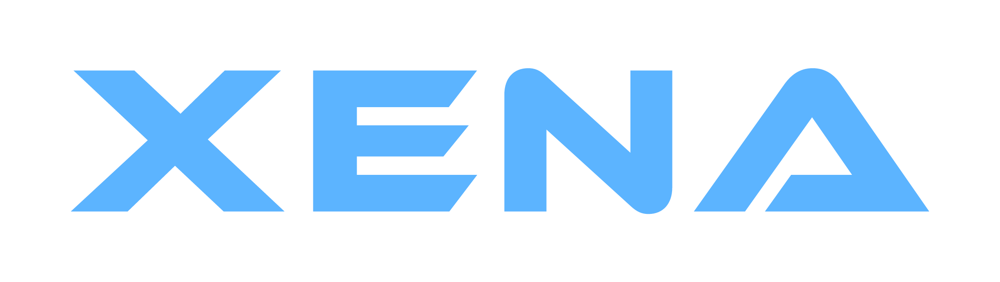 &nbsp; 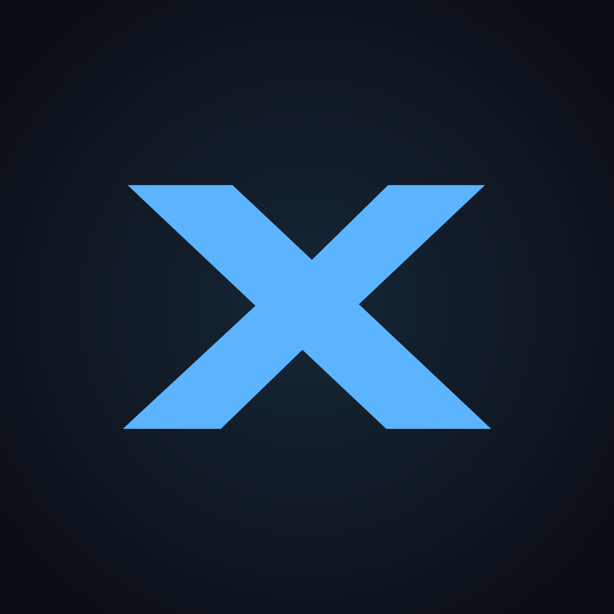

- **Clear space**: half the cap height on every side (the exported files include it).
- **Minimum size**: XENA STUDIOS 120px wide, XENA 64px wide, X 16px.
- **Backgrounds**: blue versions on `void` or `space` only. On light or photographic backgrounds, use white or black.
- **Don't** add a symbol, stars, outlines, gradients on the type, or a second accent colour. Don't set Ethnocentric in lowercase or as live web text.

## Colour

Ion Blue is the only accent. It lights the X and the horizon; everything else is neutral.

| Token | Hex | Role |
|---|---|---|
| `void` | `#06080D` | Page background |
| `space` | `#0A0E16` | Tiles, avatar |
| `surface` | `#121824` | Raised panels, planet body |
| `line` | `#222B3B` | Hairlines, borders |
| `muted` | `#8A93A6` | Secondary text, taglines |
| `text` | `#EDF1F7` | Primary text, logo |
| `accent` | `#5CB4FF` | Ion Blue: X, horizon glow |

Available as [`tokens/colors.css`](tokens/colors.css) (`--xena-*`) and [`tokens/colors.json`](tokens/colors.json).

## Typography

| Role | Face | Notes |
|---|---|---|
| Logo / display | **Ethnocentric** (Typodermic) | Caps only, always outlined |
| Taglines, labels | **JetBrains Mono** Light / Regular | Taglines in Light, labels in Regular with wide tracking |

JetBrains Mono is the one face every brand shares: the uppercase `//` kicker on every banner is set in it. Each product and the plugin family add their own sans (see [Raptor](#raptor), [NeoSkript](#neoskript), [Plugins](#plugins)).

**Ethnocentric licence.** The free Typodermic desktop licence covers logos and outlined images only. It does not allow webfonts, shipping the font in apps or sites, or sharing the font file. So the font is **not** in this repo, and every Ethnocentric letter in these files is a vector path. If live Ethnocentric text is ever needed on a website, buy a webfont licence from Typodermic first.

## Horizon

Every Xena graphic uses the same scene: a flat sky and one huge planet whose limb arcs across the bottom. Nothing else, no stars. Products draw it in their own colours (Raptor: Ink sky, Signal Red limb; NeoSkript: night sky, magenta limb), and the plugin family steps its rim into pixels.

| File | Size | Use |
|---|---|---|
| `social/x-header` | 1500×500 | X / Twitter header |
| `social/discord-banner` | 960×540 | Discord server banner |
| `social/og-card` | 1200×630 | Link preview for xenastudios.co |
| `avatar/avatar` | 512×512 | GitHub, Modrinth and social avatars |
| `avatar/favicon` | 64×64 | Favicon |
| `scene/horizon` | 2400×900 | The horizon alone, no type: website and slide backgrounds |

## People

Team profile photos (Google account, GitHub, Discord) use the avatar's style with the person's initial: Ion Blue on a `space` tile. They're square; Google and Discord crop them to a circle. Add someone to `people` in `scripts/build.mjs` and rebuild.

| File | Person |
|---|---|
| [`people/zachary.png`](people/zachary.png) | Zachary, Founder |

## Google Workspace

Upload [`workspace/logo.png`](workspace/logo.png) (320×132, Google's maximum) in the Admin console under **Account → Account settings → Personalization → Logo → Custom logo**. It shows at the top of Gmail, Calendar and Drive, and can take up to 3 days to appear.

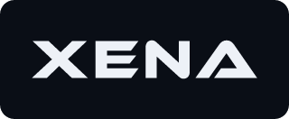

It's the short **XENA** form in black on a transparent background. Google frames the logo in white, so a dark tile looks like a box with a border; and XENA STUDIOS is illegible at the ~40px height Gmail draws it.

## Raptor

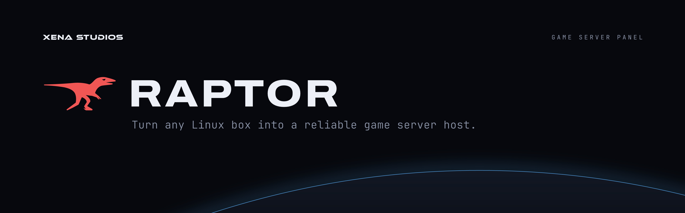

Raptor keeps its own identity, taken from [`docs/DESIGN.md`](https://github.com/xena-studios/raptor/blob/main/docs/DESIGN.md) in `xena-studios/raptor` ("The Console": Signal Red on warm Ink). Xena supplies only the horizon and the XENA STUDIOS endorsement.

### Marks

 &nbsp; 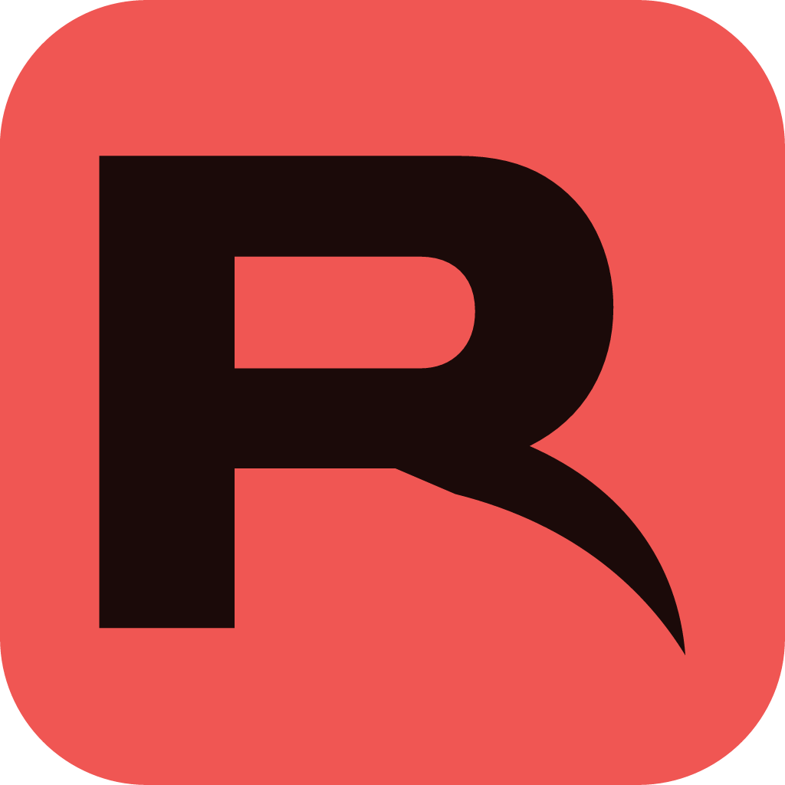

- **Full logo**: the running raptor in Signal Red beside the **RAPTOR** wordmark (Archivo ExtraBold 800, 0.06em tracking, outlined). Wherever the wordmark appears, the raptor is beside it, and the raptor never appears without the wordmark.
- **Small mark**: the R whose leg is a raptor's sickle claw, in Signal Red on its own. For 32px+ spots with no room for the full logo. Never beside the wordmark.
- **Favicon / app icon / avatar**: the claw R in Ink (`on-signal`) on a Signal Red tile with 6/32 corners.
- One flat colour per mark: no gradients, outlines or shadows. The wordmark is Bone on dark, Graphite on light; the red switches to its Daylight value on light.

### Colour

| Token | oklch | Hex | Role |
|---|---|---|---|
| `signal-red` | `oklch(0.66 0.19 25)` | `#F05653` | The one accent: raptor, marks, primary action |
| `signal-red-daylight` | `oklch(0.545 0.215 25)` | `#D01025` | Signal Red on light backgrounds |
| `on-signal` | `oklch(0.17 0.03 25)` | `#1B0A09` | Claw R on the red tile |
| `ink` | `oklch(0.145 0.012 25)` | `#0F0808` | Page / banner background |
| `ink-raised` | `oklch(0.185 0.013 25)` | `#181110` | Cards, planet body |
| `ink-rule` | `oklch(0.3 0.012 25)` | `#342C2B` | Borders, dividers |
| `bone` | `oklch(0.96 0.005 25)` | `#F5F0F0` | Text, wordmark on dark |
| `ash` | `oklch(0.68 0.011 25)` | `#9F9695` | Secondary text, kickers |
| `graphite` | `oklch(0.18 0.018 25)` | `#190F0E` | Text, wordmark on light |

The full set, including Daylight and state colours (`ok`, `warn`, `danger`), is in [`tokens/raptor.css`](tokens/raptor.css) and [`tokens/raptor.json`](tokens/raptor.json). Neutrals are tinted toward red (hue 25). Red means the action, the place, or what's live, never decoration. Green, amber and danger mean state only.

### Type

- **Hanken Grotesk** for sentences: headlines 700 with -0.025em tracking, body 400.
- **JetBrains Mono** for everything machines say and every control: labels, buttons, numbers, and the uppercase `//` kicker (+0.18em).
- **Archivo** is only the wordmark's letters.

### Files

| File | Use |
|---|---|
| `raptor/banner` | README banner, 1920×600 (PNG @2×) |
| `raptor/logo-dark`, `raptor/logo-light` | Full logo for dark / light backgrounds |
| `raptor/icon` | Favicon, app icon, avatar (512) |
| `raptor/mark` | Small claw R mark |
| `raptor/official/` | Verbatim copies from the Raptor repo: docs logos, favicon, and the site's `og.png` link preview |

The paths and tokens are vendored in [`scripts/raptor-brand.mjs`](scripts/raptor-brand.mjs) from `web/src/lib/brand.ts` and `docs/DESIGN.md`. If Raptor's marks or colours change, update that file, refresh `raptor/official/`, and rebuild.

## NeoSkript

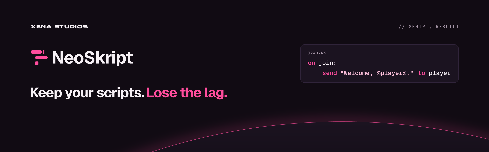

NeoSkript is a fast, modern drop-in replacement for Skript, and a product with its own identity: Neo Magenta on night. Like Raptor, Xena supplies only the horizon and the XENA STUDIOS endorsement.

**Headline:** Keep your scripts. *Lose the lag.* The two halves are the whole pitch: existing `.sk` scripts run unchanged (drop-in), and they run faster.

**Modrinth summary:** A fast, modern drop-in replacement for Skript. Your .sk scripts run unchanged, only faster. For Paper and Folia.

### Marks

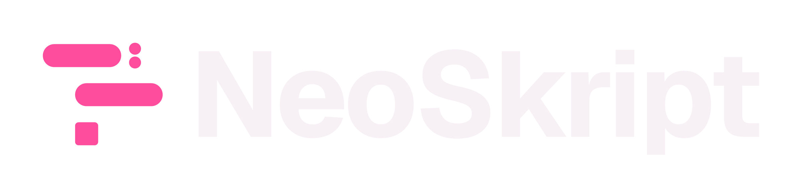 &nbsp; 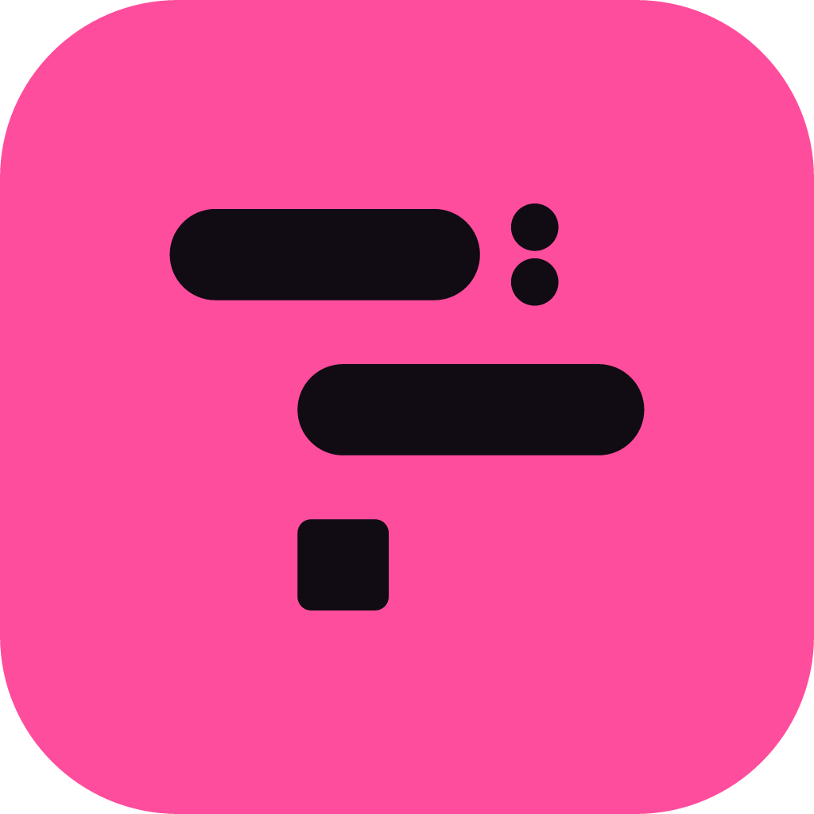

- **The mark**: a script in three strokes. An event line ending in a colon (`on join:`), the indented line under it, and the cursor. It says *Skript* to anyone who has written one, without borrowing Skript's own logo.
- **Full logo**: the mark in magenta beside the **NeoSkript** wordmark (Geist Bold, -0.03em tracking, outlined), the mark 1.2 × the cap height. Text-colour wordmark on dark, `ink` on light; the magenta switches to its Daylight value on light.
- **Icon / avatar / favicon**: the mark in `night` on a magenta tile with 7/32 corners. It's the loudest icon Xena has on purpose: on Modrinth it sits among hundreds of Skript addons.
- **Name**: always **NeoSkript**, one word, capital N and S. Never "Neo Skript", "Neoskript" or "NS".
- One flat colour per mark: no gradients, outlines or shadows.

### Colour

| Token | Hex | Role |
|---|---|---|
| `magenta` | `#FF4D9D` | The one accent: mark, headline, horizon |
| `magenta-daylight` | `#D61F78` | Magenta on light backgrounds |
| `night` | `#110B13` | Page / banner background, mark on the tile |
| `night-raised` | `#1B1320` | Cards, planet body |
| `night-rule` | `#30243A` | Borders |
| `text` | `#F7F1F6` | Text, wordmark on dark |
| `muted` | `#A898A9` | Secondary text, kickers |
| `ink` | `#1A1219` | Text, wordmark on light |
| `string` | `#FFC2DD` | String literals in code samples |

In [`tokens/neoskript.css`](tokens/neoskript.css) (`--neoskript-*`) and [`tokens/neoskript.json`](tokens/neoskript.json). Neutrals are tinted toward magenta.

### Type

- **Geist** Bold for the wordmark and headlines (-0.025em tracking).
- **Geist Mono** for code: syntax keywords in magenta, strings in `string`, everything else in `text`.
- **JetBrains Mono** for the uppercase `//` kicker, as across Xena.

### Files

| File | Use |
|---|---|
| `neoskript/banner` | README and Modrinth banner, 1920×600 (PNG @2×), with a code card showing a script that runs unchanged |
| `neoskript/social` | GitHub social preview, 1280×640 |
| `neoskript/logo-dark`, `neoskript/logo-light` | Full logo for dark / light backgrounds |
| `neoskript/icon` | Modrinth project icon, GitHub avatar, favicon (512) |
| `neoskript/mark` | The mark alone, in magenta |

Colours, the mark's geometry and the copy are in [`scripts/neoskript-brand.mjs`](scripts/neoskript-brand.mjs).

## Plugins

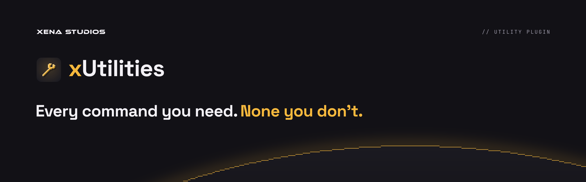

Xena's small Minecraft plugins share one family identity, endorsed by XENA STUDIOS the way the products are.

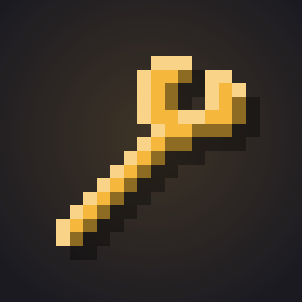 &nbsp; 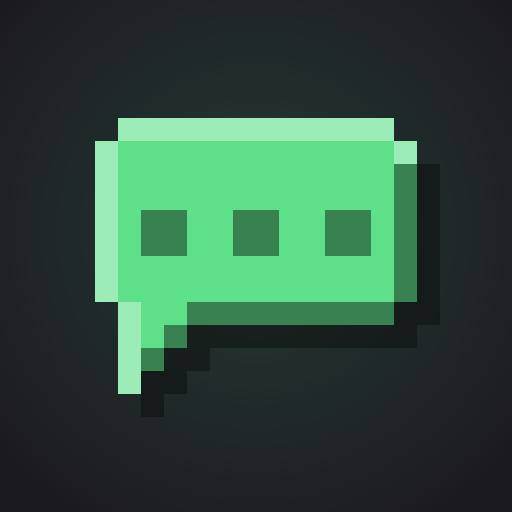 &nbsp; 

### The system

- **Icon**: a 16×16 pixel glyph, Minecraft's item size, on a `raised` tile with a soft accent glow. Shading is derived from the shape (light top-left edges, dark bottom-right, a hard drop shadow), so every glyph is lit the same way. Cells are whole pixels at every size, so the icon stays crisp at Modrinth's 96px and 48px.
- **Name**: the prefix letter in the plugin's accent, the rest in `text`, Space Grotesk Bold. The lowercase prefix stays: xUtilities, zChat, xLimbo.
- **Banner**: Raptor's layout. XENA STUDIOS top-left, the `//` kicker top-right, the icon + name lockup, a two-tone headline ending in the accent, and the horizon with its rim stepped into pixels.
- **One accent per plugin**, never one another brand uses.
- **Adding a plugin**: draw a 16×16 glyph and pick an unused accent in [`scripts/plugin-brand.mjs`](scripts/plugin-brand.mjs), then rebuild.

### Lineup

| Plugin | Accent | Glyph | Headline | Modrinth summary |
|---|---|---|---|---|
| **xUtilities** | `#F5B83D` amber | wrench | Every command you need. *None you don't.* | Every command you need, none you don't: gamemodes, fly, heal, /back, workstations and your own link commands, each one toggleable. For Paper and Folia. |
| **zChat** | `#5EE08A` green | chat bubble | Format your chat. *Keep it clean.* | Group-based chat formatting with a filter, cooldown and chat mute, rendered once per message so it costs next to nothing. For Paper and Folia. |
| **xLimbo** | `#B48CFF` violet | block over a glass floor | Never drop *a player again.* | A fallback server for your network. When the main server goes down, players wait in a safe void world instead of being kicked, then hop back with /join. |

### Colour

| Token | Hex | Role |
|---|---|---|
| `bg` | `#121116` | Banner background (deepslate) |
| `raised` | `#1B1A21` | Icon tile, planet body |
| `rule` | `#2A2832` | Borders |
| `text` | `#F2F0F5` | Names, headlines, XENA STUDIOS |
| `muted` | `#9C99A8` | Kickers, secondary text |

In [`tokens/plugins.css`](tokens/plugins.css) (`--plugin-*`, plus `--plugin-<id>` for each accent) and [`tokens/plugins.json`](tokens/plugins.json).

### Type

- **Space Grotesk** Bold for names and headlines.
- **JetBrains Mono** for kickers and labels, as across Xena.

### Files

| File | Size | Use |
|---|---|---|
| `plugins/<id>/icon` | 512×512 | Modrinth project icon, GitHub repo avatar |
| `plugins/<id>/banner` | 1920×600 (PNG @2×) | Top of the Modrinth description and the README |
| `plugins/<id>/social` | 1280×640 | GitHub social preview |

## Where each file goes

| Place | File |
|---|---|
| GitHub org avatar, Modrinth org icon | `avatar/avatar.png` |
| GitHub org profile header (`.github`) | `social/x-header.png` |
| X / Twitter header, Discord banner | `social/x-header.png`, `social/discord-banner.png` |
| xenastudios.co favicon, link preview | synced into `xena-studios/website` by its `npm run brand:sync` |
| Google Workspace header logo | `workspace/logo.png` |
| Team profile photos | `people/<name>.png` |
| Raptor README | `raptor/banner.png` |
| NeoSkript Modrinth icon / description banner | `neoskript/icon.png`, `neoskript/banner.png` |
| Plugin Modrinth icon / description banner | `plugins/<id>/icon.png`, `plugins/<id>/banner.png` |
| GitHub repo social preview (Settings → Social preview) | `neoskript/social.png`, `plugins/<id>/social.png` |

## Build

Every asset is generated by [`scripts/build.mjs`](scripts/build.mjs). Fonts go in `.local-fonts/`, which git ignores; every letter in the output is outlined, so no font file ever ships.

| File in `.local-fonts/` | Face | Source |
|---|---|---|
| `Ethnocentric-Regular.otf` | Ethnocentric | Your own licensed copy from Typodermic |
| `HankenGrotesk-700.ttf` | Hanken Grotesk Bold (OFL) | Google Fonts, static instance |
| `SpaceGrotesk-700.ttf` | Space Grotesk Bold (OFL) | github.com/floriankarsten/space-grotesk, `fonts/ttf/static` |
| `Geist-700.ttf`, `GeistMono-500.ttf` | Geist Bold, Geist Mono Medium (OFL) | github.com/vercel/geist-font |

JetBrains Mono Regular and Light are read from `~/Library/Fonts`. Override any path with `ETHNOCENTRIC=`, `MONO=`, `MONO_LIGHT=`, `HANKEN_BOLD=`, `GROTESK_BOLD=`, `GEIST_BOLD=` or `GEIST_MONO=`.

```sh
npm install
npm run build
```

The build is deterministic: running it twice changes nothing. Commit the generated files with the change that produced them.
