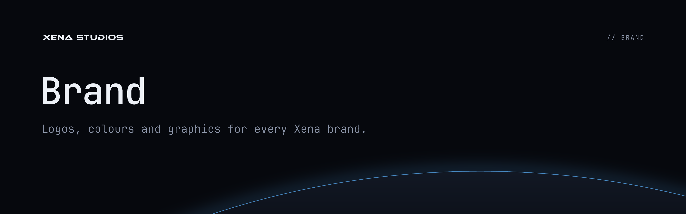
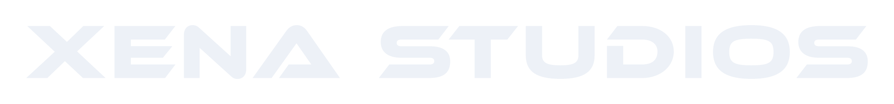
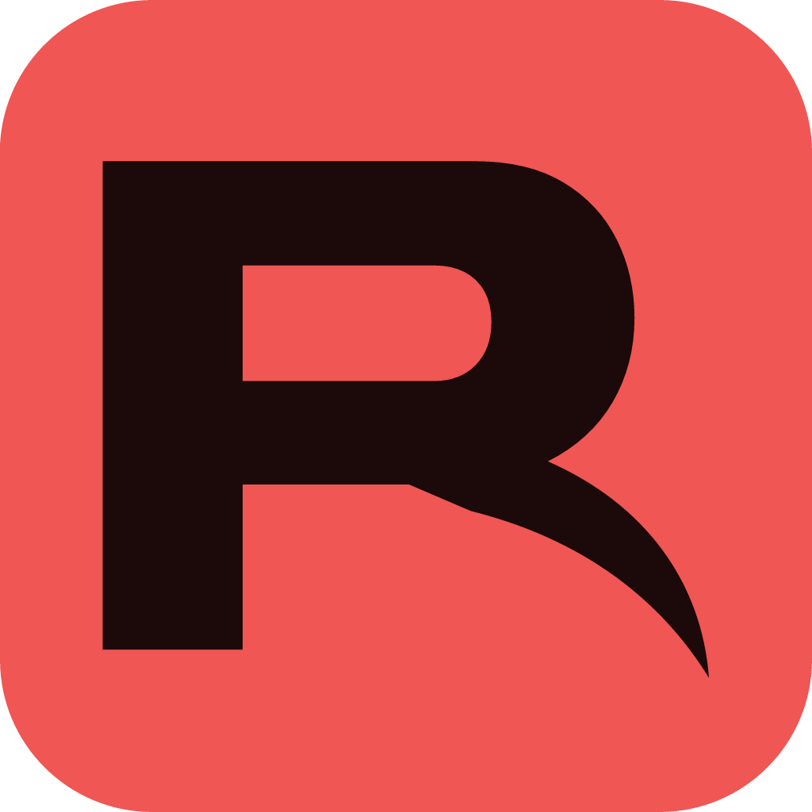
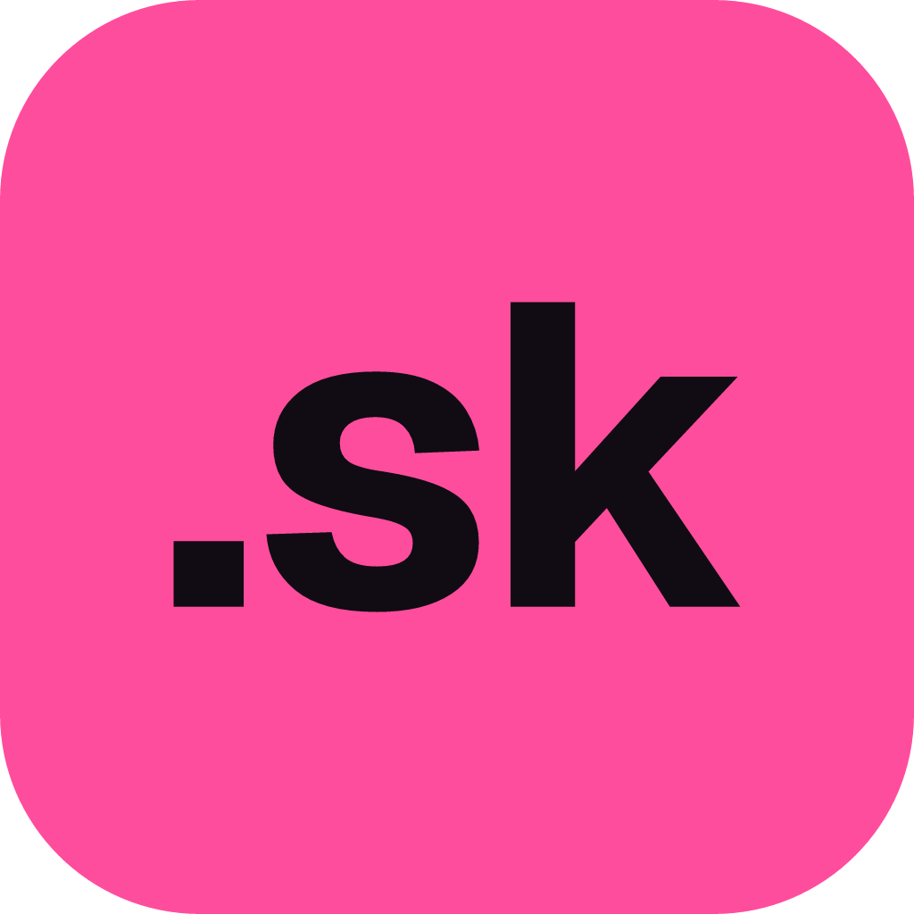
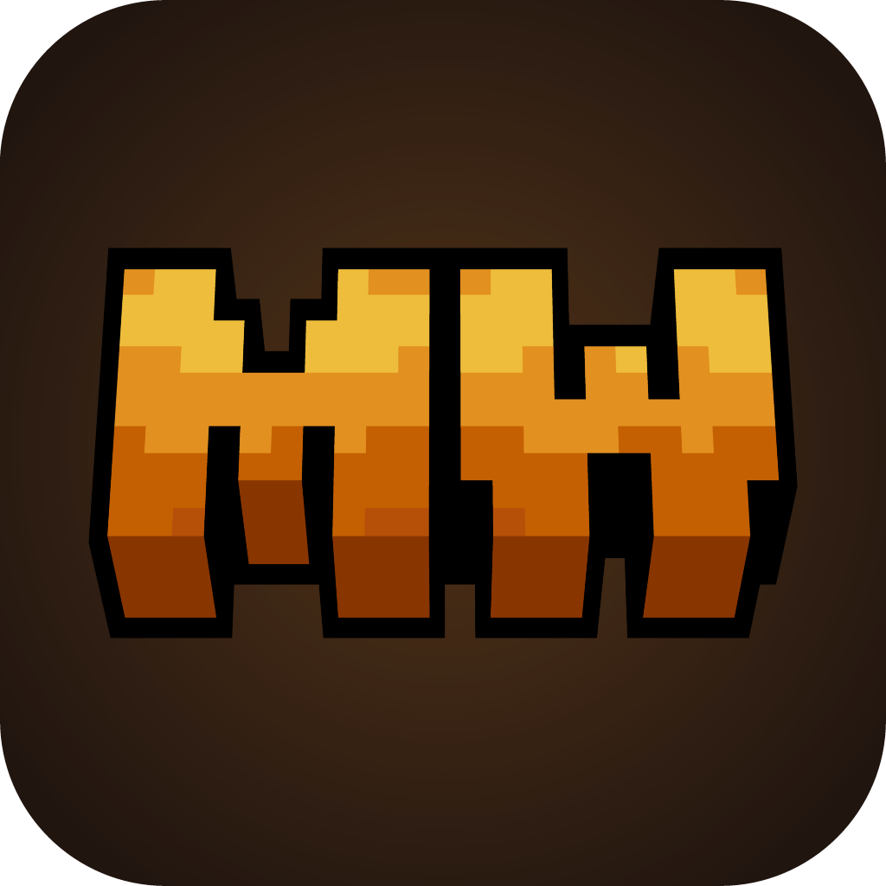
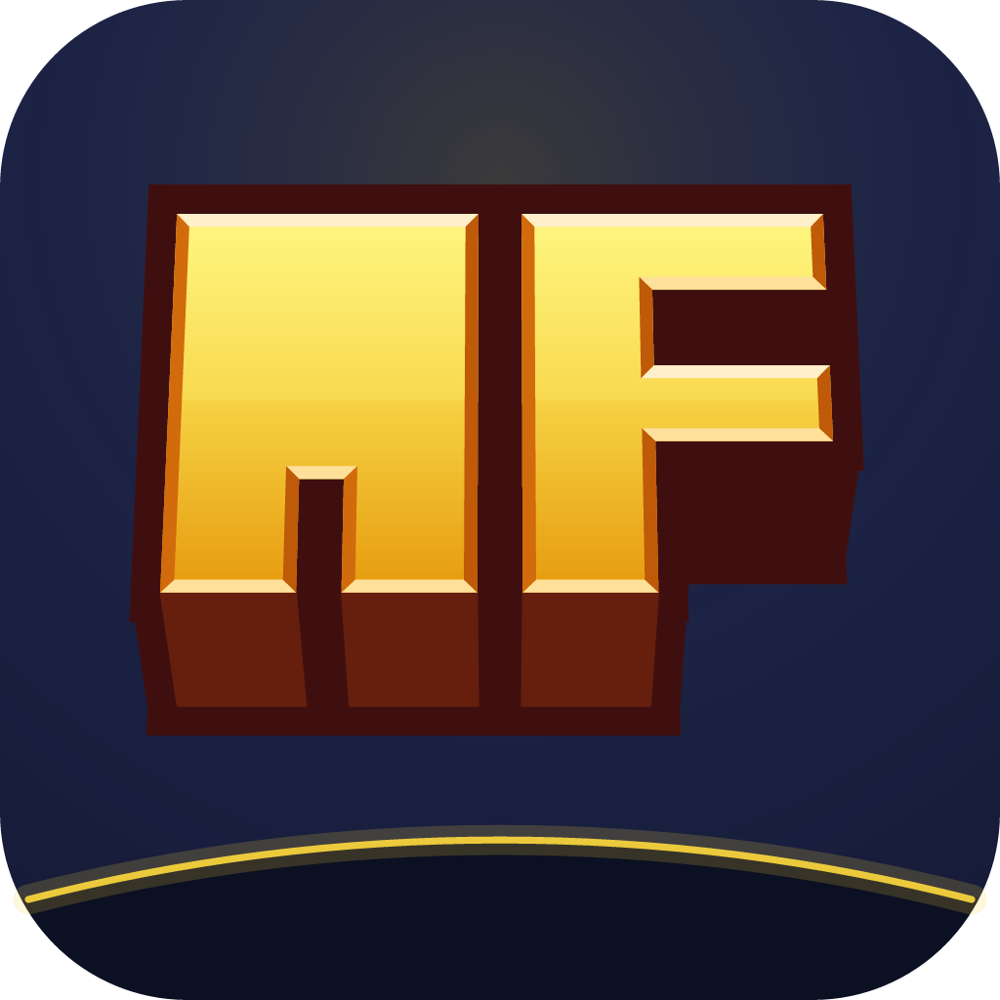
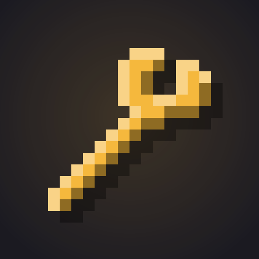
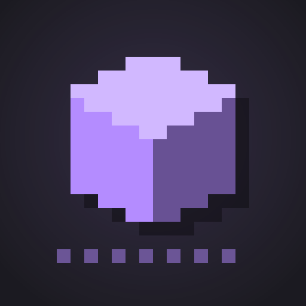

**Logos, colours and graphics for every Xena brand.**

Every logo, colour token and graphic for Xena Studios and its products. All of it is generated from code by [`scripts/build.ts`](scripts/build.ts).

## How the brands fit together

| Tier | Brands | Identity |
|---|---|---|
| **Studio** | Xena Studios | Type only, Ion Blue on deep space |
| **Products** | Raptor, NeoSkript, MostWanted, Airfields | Each has its own mark, colours and type, endorsed by XENA STUDIOS |
| **Plugins** | xUtilities, zChat, xLimbo | One shared system: a pixel glyph and an accent each |

Two things tie them together: the **XENA STUDIOS** endorsement and the planet **horizon**. Every brand also has its own accent, and no two share one.

 &nbsp;       

## Guides

| Guide | What's in it |
|---|---|
| [Xena Studios](docs/xena.md) | The logo, Ion Blue, type, the horizon, repo cards, team photos |
| [Raptor](docs/raptor.md) | Signal Red, the raptor and claw marks |
| [NeoSkript](docs/neoskript.md) | Neo Magenta and the `.sk` mark |
| [MostWanted](docs/mostwanted.md) | Desert Orange and the block wordmark |
| [Airfields](docs/airfields.md) | Airfields Gold, the gold wordmark, and the seasonal themes |
| [Plugins](docs/plugins.md) | The pixel-glyph system, and how to add a plugin |
| [Where each file goes](docs/where-files-go.md) | Which file to upload or copy where |
| [Building](docs/building.md) | Fonts, the build, and checks |

Colour tokens for every brand are in [`tokens/`](tokens/), as CSS and JSON.

## Build

Needs Node 24 and pnpm. The build also needs fonts that aren't in the repo; see [Building](docs/building.md).

```sh
pnpm install
pnpm build    # regenerate every asset
pnpm check    # rebuild, and fail if anything committed is out of date
pnpm verify   # no fonts needed: what CI runs
```

## Making changes

- Changes go through pull requests, and `check` has to pass. Run `pnpm check` first and commit the regenerated files with your change.
- Commits follow [Conventional Commits](https://www.conventionalcommits.org): `feat:` for a new or changed asset, plus `fix:`, `docs:`, `build:` and `ci:`.
- Other repos only pick up a change when they copy it in. The website and the plugin docs use `pnpm brand:sync`; everything else is copied by hand.

## Licence

All rights reserved. The logos, graphics, tokens and scripts are © Xena Studios and aren't licensed for other use. No font files are in the repo: Ethnocentric appears only as outlines, as its licence allows, and the other faces are under the [SIL Open Font License](https://openfontlicense.org).
