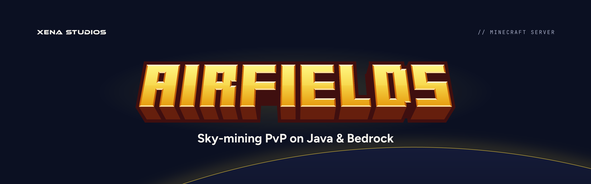
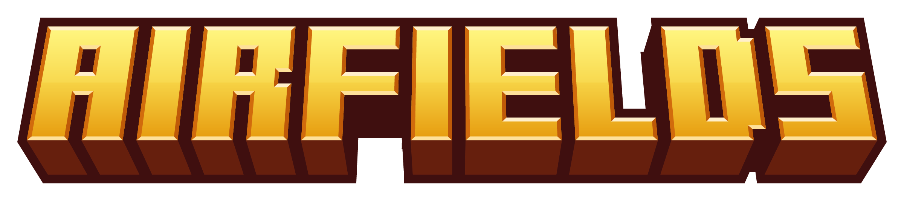
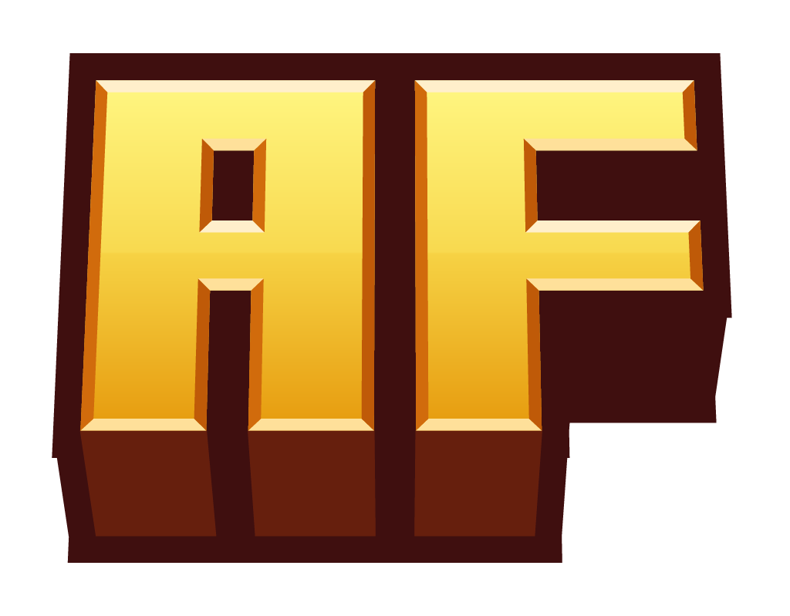
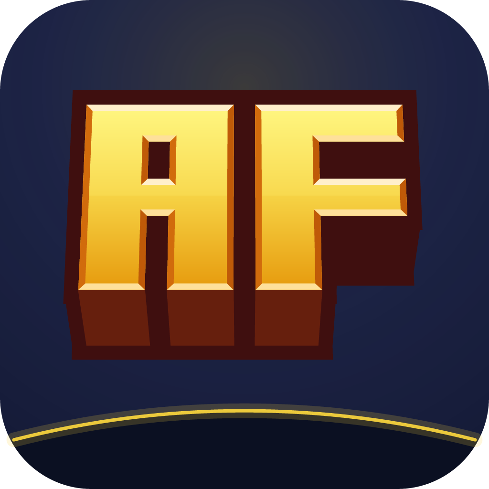
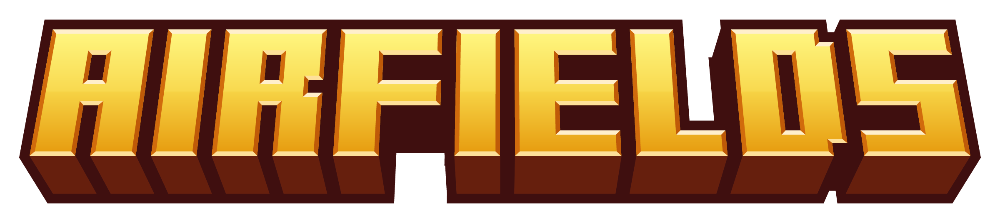
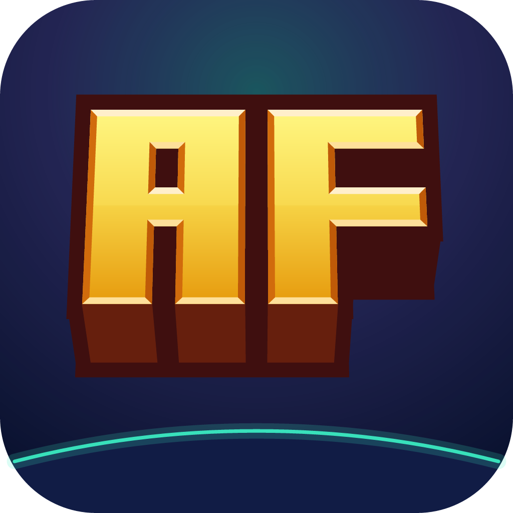
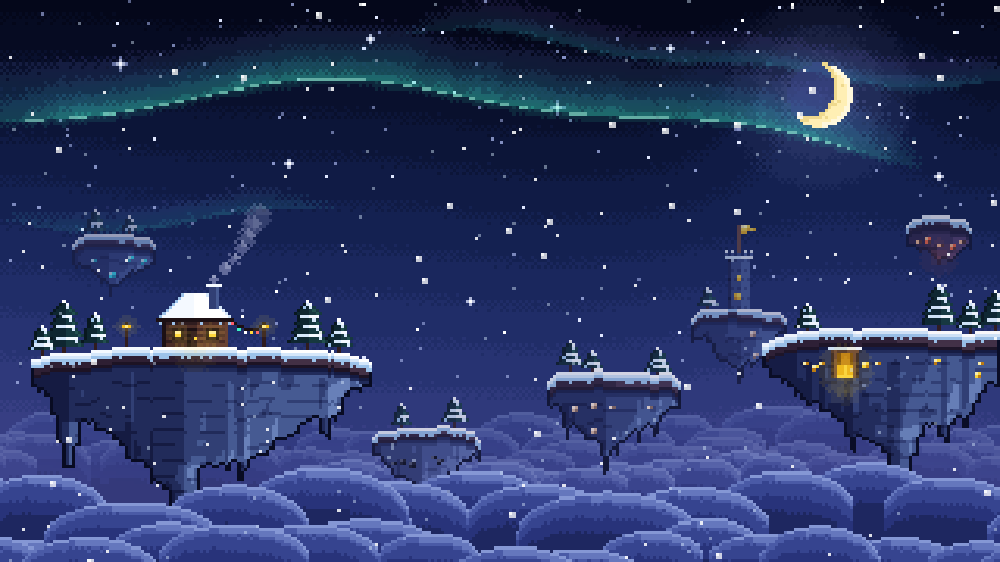

# Airfields

Airfields Gold on a high-altitude night. Xena adds the XENA STUDIOS endorsement, the `//` kicker and the horizon. The game itself is in xena-studios/airfields (private).

- **Tagline:** Sky-mining PvP on Java & Bedrock.
- **Summary:** A sky-mining PvP Minecraft server for Java and Bedrock. Mine floating islands, fight ore mobs, forge your gear and hold KOTH.
- **Name:** always **Airfields**, one word with a capital A. Handles and the domain add MC (`airfieldsmc`, airfieldsmc.com). In listings, pair it with what it is: *Airfields — Sky-Mining PvP*.

## Marks

 &nbsp;  &nbsp; 

- **Wordmark:** **AIRFIELDS** in block title lettering, like a game's title screen: chunky letters on a grid, a gold face lit from above (pale at the top, deep gold at the foot), bevelled edges, a deep brown extrusion under the baseline and one thick maroon outline around it all. The letters lean out slightly toward the bottom. It's lettering drawn on a grid, not a font, so **always use the file and never retype it**.
- **Monogram:** **AF** in the same lettering, for small and square spots.
- **The A's emblem:** the A has a square counter like the R and a plain face. Each season can cut its emblem into it in the same bevelled style (winter keeps the plain A). Never put a creeper or any other Minecraft mark in it.
- **Icon:** the monogram standing on a small horizon, on a `sky-raised` tile with a soft gold glow, 6/32 corners. It clears Discord's circle crop. At 64px and below (the favicon, the Minecraft server list) the monogram fills the tile, drops its bevels and emblem, and the horizon drops out.
- **Clear space:** the exported files include it. **Minimum size:** the wordmark 160px wide, the icon 16px.
- **Don't** recolour the gold or the outline, add a second outline, redraw the letters, or put a season's emblem on the permanent files.

The lettering is drawn by [`scripts/airfields-logo.ts`](../scripts/airfields-logo.ts), recreated from the owner's original artwork: each letter's cells, the lean, the extrusion, the bevel and outline widths and the colours are measured from it.

## Colour

| Token | Hex | Role |
|---|---|---|
| `gold` | `#FFD93D` | **Airfields Gold**, the one accent: buttons, highlights, the horizon's rim |
| `gold-daylight` | `#7A5600` | Gold text on light backgrounds |
| `sky` | `#0B1022` | Background |
| `sky-raised` | `#151B38` | Cards, icon tile, planet body |
| `sky-rule` | `#283058` | Borders |
| `text` | `#F6F4EE` | Text on dark |
| `muted` | `#A7ADC6` | Secondary text, kickers |
| `ink` | `#1A1405` | Text on light and on gold, the logo's outline |
| `cloud` | `#F6F7FB` | Light backgrounds |
| `gold-light`, `gold-deep`, `bronze`, `bronze-dark` | `#FFF3B0`, `#F0B312`, `#A8700A`, `#5A3A06` | Golds and browns for illustration only |
| `title-extrusion`, `title-outline` | `#661F0D`, `#3F0F0F` | The wordmark's extrusion and outline, for illustration only |

Airfields Gold sits at OKLCH hue 96, a lemon gold, so it stays clear of the plugin family's amber (xUtilities, hue 81) and MostWanted's Desert Orange (hue 60). In [`tokens/airfields.css`](../tokens/airfields.css) (`--airfields-*`) and [`tokens/airfields.json`](../tokens/airfields.json). Use `gold-daylight`, not `gold`, for text on white.

## Type

- The wordmark and monogram are lettering, not type. On graphics and the site, **Unbounded** Bold for headings and **Figtree** for taglines and text.
- **JetBrains Mono** for the `//` kicker, as on every Xena banner. The game's website uses IBM Plex Mono for labels.

## Seasons

The game changes its look with the season; the permanent brand above doesn't. Each season is a **theme**: its own sky, horizon rim and glow, the emblem it cuts into the A, and optionally a pixel scene. A theme may add weather to its own graphics (winter's falling snow), which the permanent files never have. Theme files are in `airfields/themes/<id>/`, and the theme definitions are in `themes` in [`scripts/airfields-brand.ts`](../scripts/airfields-brand.ts).

### Winter (2026)

 &nbsp; 

The plain A, a navy sky with an aurora glow and falling snow, and an aurora-teal horizon. For the game's site, Discord and listings while the winter season runs.

**The pixel scene** is winter's key art, the counterpart of MostWanted's pixel desert: the island route floating over a sea of cloud on a winter night. The hub on the left (a cabin with lit windows and chimney smoke, lanterns, a string of lights), coal and iron in the middle, the KOTH island with its tower and flag beside iron, gold on the right with its mine glowing, and diamond and netherite farther off and higher. Each island's rock shows its ore. Farther islands are smaller, bluer and flatter. The sky above the middle stays calm for the wordmark.

It's pixel art drawn by code, pixel by pixel, in [`scripts/airfields-scene.ts`](../scripts/airfields-scene.ts): a 320×180 canvas (stepped sky bands with ordered dithering, stars, a crescent moon, aurora curtains, cloud billows, the islands, falling snow), scaled up with nearest neighbour so every art pixel stays a square. Show it with `image-rendering: pixelated` when the browser scales it. The key art blurs it under the wordmark, as MostWanted's does; the winter banner and social preview use the same blurred scene.

| Token | Hex | Role |
|---|---|---|
| `navy` | `#0A1230` | The season's sky |
| `night`, `night-raised` | `#111C45`, `#1B2A62` | Planet body, cards |
| `frost`, `frost-shade` | `#F4F9FF`, `#9CC2E9` | Snow, the cap's shadow |
| `aurora-teal`, `aurora-violet` | `#3CF2C6`, `#9A7BFF` | The horizon's rim and the glow, never text |

In [`airfields/themes/winter/colors.json`](../airfields/themes/winter/colors.json).

To add a season: add a theme to `themes` (copy winter's: `sky`, `body`, `rim`, `glow`, and optionally `emblem`, `scenery` and `scene`), run `pnpm build:airfields`, and commit `airfields/themes/<id>/`. A new season's scene is drawn in `scripts/airfields-scene.ts`. The game repo then syncs it (its `brand:sync`).

## Files

| File | Use |
|---|---|
| `airfields/wordmark` | The wordmark, transparent |
| `airfields/monogram` | The A, transparent |
| `airfields/icon` | Avatar, Discord, store (512) |
| `airfields/favicon` | Favicon (64) |
| `airfields/server-icon` | The Minecraft server list's `server-icon.png` (64×64, square) |
| `airfields/banner` | README banner (1920×600) |
| `airfields/social` | GitHub social preview (1280×640) |
| `airfields/themes/<id>/` | The season's wordmark, monogram, icon, server icon, banner and social preview |
| `airfields/themes/winter/scene.png` | The pixel scene, unblurred (1280×720, 4×) |
| `airfields/themes/winter/scene-1920x1080.png` | The same at 6×: the website hero |
| `airfields/themes/winter/scene-320x180.png` | The same at 1×, for the browser to scale with `image-rendering: pixelated` (smallest file) |
| `airfields/themes/winter/banner-scene.png` | A wide band of it (3840×1200, 12×): headers and banners with no logo |
| `airfields/themes/winter/key-art.png` | Key art (1920×1080): the winter wordmark over the blurred scene. Site hero, listings, thumbnails, Discord |
| `airfields/themes/winter/scene.json` | Where the bright stars are, in 1× pixels, for a site that makes them twinkle |

Colours and copy are in [`scripts/airfields-brand.ts`](../scripts/airfields-brand.ts), the lettering in [`scripts/airfields-logo.ts`](../scripts/airfields-logo.ts) and the scene in [`scripts/airfields-scene.ts`](../scripts/airfields-scene.ts). `pnpm build:airfields` rebuilds only these files and needs only Figtree and JetBrains Mono (see [Building](building.md#fonts)).
