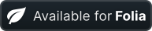

# Badges

Our READMEs and Modrinth pages use [Devin's Badges](https://github.com/intergrav/devins-badges): dark tiles with an icon and a two-tone line, the look most Minecraft projects use. They're CC0, so there's nothing to credit or ask.

The library doesn't have everything we need, so `badges/` adds the rest in the same style, drawn by [`scripts/badges.ts`](../scripts/badges.ts). Ours sit in the same row as the library's and look like part of it.

## Where the files come from

| Badges | URL |
|---|---|
| The library's | `https://cdn.jsdelivr.net/npm/@intergrav/devins-badges@3/assets/<style>/<category>/<name>_vector.svg` |
| Ours | `https://raw.githubusercontent.com/xena-studios/brand/main/badges/<style>/<category>/<name>.svg` |

Link the library from jsDelivr pinned to `@3`: a new major version can't change our pages under us, and nothing has to be copied or kept up to date. Ours are served from this repo, the same way the Modrinth pages already show the plugin banners.

Every badge comes in the library's four styles: `cozy` (56px tall, two lines), `compact` (40px, one line), and `cozy-minimal` and `compact-minimal` (the icon alone).

## Ours

| Badge | Path | Why we draw it |
|---|---|---|
|  | `badges/<style>/supported/folia` | The library has Paper, Purpur, Spigot, Bukkit and Velocity, but no Folia |
|  | `badges/<style>/documentation/docs` | The library's docs badges are for GitBook, Read the Docs (the service) or a generic website. Ours says the link is the docs |

To add one, add it to `badges` in `scripts/badges.ts` (its category, the label and name, a white icon as path data, and why), run `pnpm build:badges`, and add it to this table. Before drawing one, check the [badge reference](https://intergrav.github.io/devins-badges-docs/badges/): use the library's when it has it. If a badge would be useful to other projects too, it's worth [asking for it upstream](https://github.com/intergrav/devins-badges/issues).

Folia's leaf is PaperMC's (MIT), which is Material Design Icons' leaf (Apache 2.0). The book is our own.

## Where they go

| Page | Style and height | Badges, in this order |
|---|---|---|
| A repo README on GitHub | `compact`, 32px | Where to get it, what it runs on, the docs |
| A Modrinth page | `cozy`, 48px | What it runs on, the docs |
| The website, the org profile | None | Their own links and logos already say it |

- **Where to get it** first: `available/modrinth` once it's on Modrinth, otherwise `available/github` to its download page. Never on its own Modrinth page, where it's what you're already looking at.
- **What it runs on:** `supported/paper`, `supported/purpur` and our `supported/folia`, only the ones it really runs on. A plugin's `build.gradle.kts` says whether it runs on Folia, and the plugins repo's catalog reads it from there.
- **The docs:** our `documentation/docs` for a docs site, or the library's `documentation/website` for a product's main website.
- One row, under the tagline. Never above the banner, and never more than five: past that they stop being read.
- Write the `alt` as the badge reads ("Available for Folia"), so it makes sense without the picture.

The plugins repo writes its rows itself (its docs/scripts/catalog.ts, between `badges:start` and `badges:end`), so a new plugin or one that gains Folia gets the right row without anyone editing a README. Elsewhere they're written by hand, as HTML so the height is set:

```html
<a href="https://modrinth.com/plugin/neoskript"></a>

```
