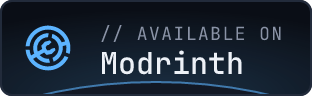
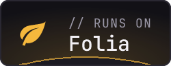
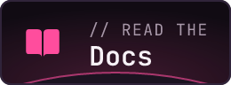

# Badges

The row of badges under a README's or Modrinth page's tagline: where to get the project, what it runs on, and where its docs are. Every brand uses the same badges, with the same icons and layout. Only the colours change, so a plugin's badges match its banner.

   

Drawn by [`scripts/badges.ts`](../scripts/badges.ts), which `pnpm build` runs; `pnpm build:badges` builds only these.

## The look

- A tile in the brand's background, with a border in its rule colour.
- The logo in the brand's accent, the only colour on the badge.
- JetBrains Mono, the face every brand shares: a muted `//` kicker ("// RUNS ON") over the name, or both on one line on compact.
- On cozy, the horizon along the bottom edge: the planet in the brand's raised colour with its rim in the accent, stepped into pixels for the plugins.

## Themes

| Theme | Folder | Accent |
|---|---|---|
| Xena Studios | `badges/xena/` | Ion Blue |
| NeoSkript | `badges/neoskript/` | Neo Magenta |
| Raptor | `badges/raptor/` | Signal Red |
| Each plugin | `badges/plugins/<id>/` | The plugin's accent, lifted where it's too dark to read, as the docs do |

## Badges

Each theme has every badge in two styles: `cozy/` (48px tall, two lines) and `compact/` (32px, one line).

| Badge | Says | Link it to |
|---|---|---|
| `modrinth` | Available on Modrinth | The Modrinth page |
| `github` | Available on GitHub | The download page or releases |
| `paper`, `purpur`, `folia` | Runs on Paper / Purpur / Folia | Nothing |
| `docs` | Read the Docs | The docs |
| `website` | Visit the Website | The product's website |
| `discord` | Chat on Discord | The Discord invite |

The platforms' logos are Devin's Badges' drawings of them ([intergrav/devins-badges](https://github.com/intergrav/devins-badges), CC0), in [`scripts/badge-icons.ts`](../scripts/badge-icons.ts). Folia's leaf is PaperMC's (MIT), from Material Design Icons (Apache 2.0). The book is our own.

To add a badge, add it to `badges` in `scripts/badges.ts`: the kicker, the name, and a one-colour icon. Then run `pnpm build:badges`. Every theme gets it.

## Where they go

| Page | Style | Badges, in this order |
|---|---|---|
| A repo README on GitHub | `compact` | Where to get it, what it runs on, the docs |
| A Modrinth page | `cozy` | What it runs on, the docs |
| The website, the org profile | None | Their own links and logos already say it |

- Use the project's own theme: a plugin's from `badges/plugins/<id>/`, the plugins repo's own README from `badges/xena/`.
- **Where to get it** comes first: `modrinth` once it's on Modrinth, otherwise `github` linking to its download page. Don't put it on the Modrinth page itself, since that's where the reader already is.
- **What it runs on:** only the platforms it really runs on. A plugin's `build.gradle.kts` says whether it runs on Folia.
- One row, under the tagline. Never above the banner, and never more than five badges: past that they stop being read.
- Write the `alt` as the badge reads ("Runs on Folia"), so it makes sense without the picture.

Link them from a release, through jsDelivr pinned to the major version (`https://cdn.jsdelivr.net/gh/xena-studios/brand@1/badges/...`), as [Linking files](where-files-go.md#linking-files) explains. The plugins repo writes its rows itself, with its docs/scripts/catalog.ts between `badges:start` and `badges:end`. Elsewhere, write the HTML by hand so the height is set:

```html
<a href="https://modrinth.com/plugin/neoskript"></a>
```
