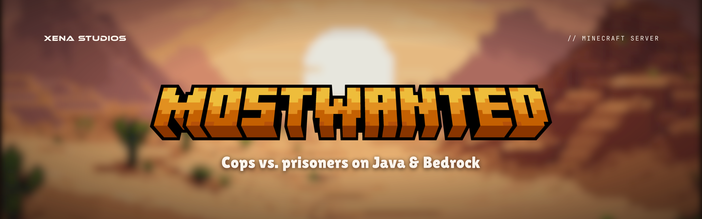
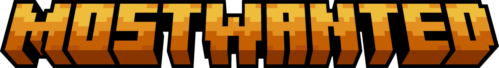
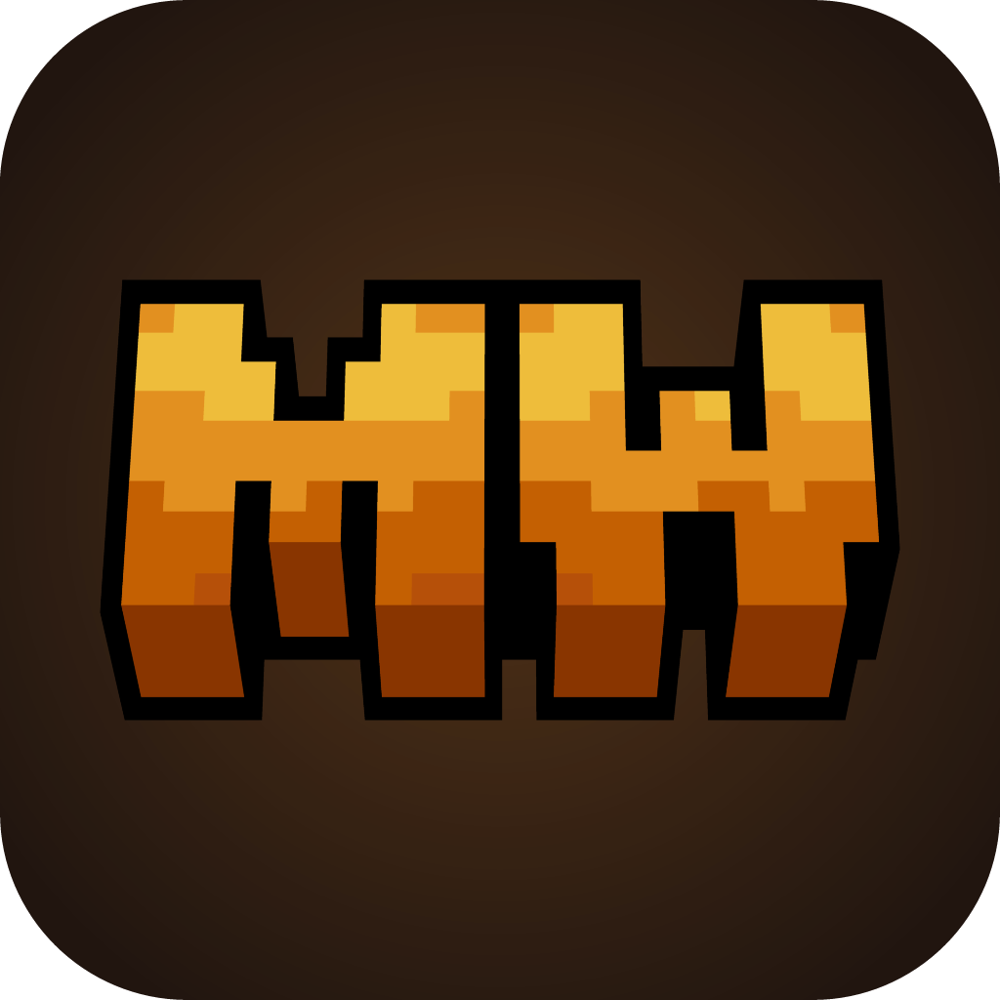

# MostWanted

Desert Orange on dusk. Xena adds the XENA STUDIOS endorsement and the `//` kicker. The game itself is in [xena-studios/mostwanted](https://github.com/xena-studios/mostwanted).

- **Tagline:** Cops vs. prisoners on Java & Bedrock.
- **Summary:** A Jailbreak-style cops vs. prisoners Minecraft server, for Java and Bedrock. Break out, rob the town, and stay ahead of the guards.
- **Name:** always **MostWanted**, one word with a capital M and W. Handles and the domain add MC (`mostwantedmc`, mostwantedmc.com). In listings, pair it with "Minecraft", since "Most Wanted" alone is a crowded search.

## Marks

 &nbsp; 

- **Wordmark:** **MOSTWANTED** in blocky Minecraft-style letters. It's pixel art, not a font, so always use the file and never retype it.
- **Monogram:** **MW** in the same style, for small and square spots.
- **Icon:** the monogram on a `dusk-raised` tile with a soft orange glow.
- **Key art:** the wordmark over the blurred pixel desert at sunset. This is MostWanted's horizon, used on its banners, site and listings.

## Colour

| Token | Hex | Role |
|---|---|---|
| `orange` | `#FF9933` | The one accent: buttons, highlights |
| `orange-daylight` | `#B34700` | Orange text on light backgrounds |
| `dusk` | `#150D09` | Background |
| `dusk-raised` | `#21150F` | Cards, icon tile |
| `dusk-rule` | `#3B2A20` | Borders |
| `text` | `#FBF4EC` | Text on dark |
| `muted` | `#B8A797` | Secondary text, kickers |
| `ink` | `#1C110B` | Text on light and on orange |
| `sand-light` | `#FBF6F0` | Light backgrounds |
| `sand`, `amber`, `burnt`, `clay` | `#EEBD3B`, `#E29020`, `#C46002`, `#893500` | The wordmark's bands, for illustration only |

In [`tokens/mostwanted.css`](../tokens/mostwanted.css) (`--mostwanted-*`) and [`tokens/mostwanted.json`](../tokens/mostwanted.json). Use `orange-daylight`, not `orange`, for text on white. In-game colours are in [the game's brand doc](https://github.com/xena-studios/mostwanted/blob/main/docs/09-brand.md).

## Type

- **Lilita One** for taglines and headlines on graphics.
- **JetBrains Mono** for the `//` kicker.

## Files

| File | Use |
|---|---|
| `mostwanted/banner` | README banner (1920×600) |
| `mostwanted/social` | GitHub social preview (1280×640) |
| `mostwanted/icon` | Avatar, Discord, store (512) |
| `mostwanted/favicon` | Favicon (64) |
| `mostwanted/official/wordmark.png`, `monogram.png` | The logos |
| `mostwanted/official/desert.png` | The pixel desert, unblurred |
| `mostwanted/official/key-art.png` | Key art (1920×1080): site hero, listings, thumbnails |

Colours and copy are in [`scripts/mostwanted-brand.ts`](../scripts/mostwanted-brand.ts). `mostwanted/official/` is copied from the mostwanted repo (`brand/source/` and `brand/out/key-art-1920x1080.png`). Refresh it when those change.
