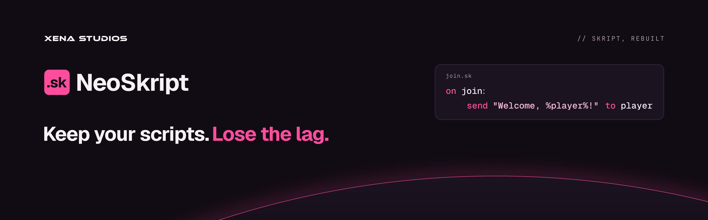
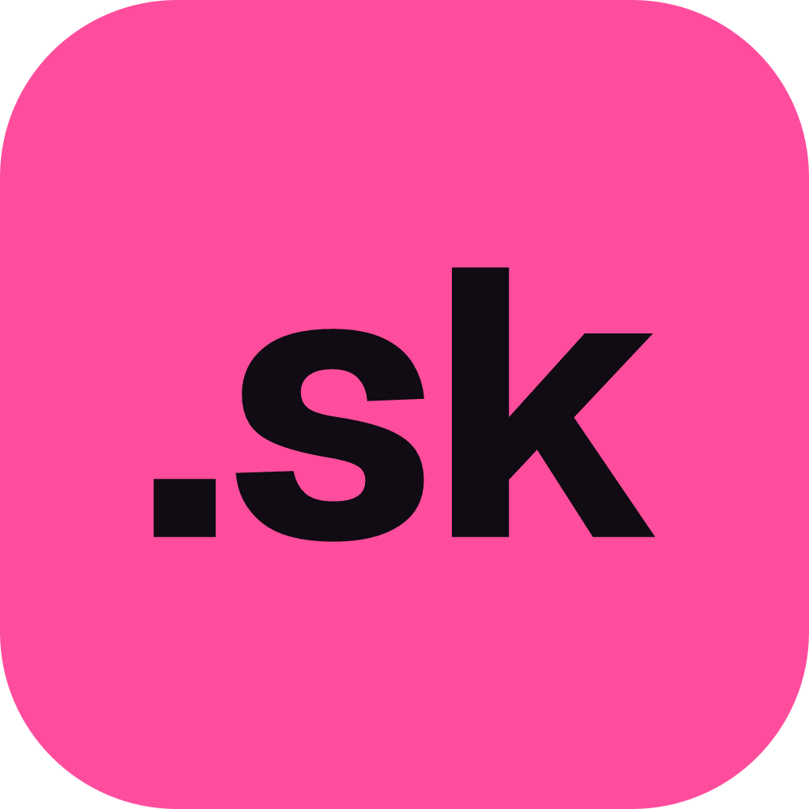

# NeoSkript

Neo Magenta on night. Xena adds the horizon and the XENA STUDIOS endorsement.

- **Headline:** Keep your scripts. *Lose the lag.* (They run unchanged, and they run faster.)
- **Summary:** A fast, modern drop-in replacement for Skript. Your .sk scripts run unchanged, only faster. For Paper and Folia.
- **Name:** always **NeoSkript**, one word with a capital N and S. Never "Neo Skript", "Neoskript" or "NS".

## Marks

 &nbsp; 

- **The mark:** **`.sk`**, the Skript file extension. Every Skript user knows it means their scripts.
- **Icon:** `.sk` in `night` on a magenta tile. It's bright on purpose, to stand out among hundreds of Skript addons on Modrinth, and stays readable at 32px.
- **Full logo:** the icon tile beside the **NeoSkript** wordmark. On light backgrounds the wordmark is `ink` and the tile is `magenta-daylight`.
- One flat colour per mark: no gradients, outlines or shadows.

## Colour

| Token | Hex | Role |
|---|---|---|
| `magenta` | `#FF4D9D` | The one accent: mark, headline, horizon |
| `magenta-daylight` | `#D61F78` | Magenta on light backgrounds |
| `night` | `#110B13` | Background, the `.sk` on the tile |
| `night-raised` | `#1B1320` | Cards, planet body |
| `night-rule` | `#30243A` | Borders |
| `text` | `#F7F1F6` | Text on dark |
| `muted` | `#A898A9` | Secondary text, kickers |
| `ink` | `#1A1219` | Text on light |
| `string` | `#FFC2DD` | Strings in code samples |

In [`tokens/neoskript.css`](../tokens/neoskript.css) (`--neoskript-*`) and [`tokens/neoskript.json`](../tokens/neoskript.json).

## Type

- **Geist** Bold for the wordmark and headlines.
- **Geist Mono** for code: keywords in magenta, strings in `string`, the rest in `text`.
- **JetBrains Mono** for the `//` kicker.

## Files

| File | Use |
|---|---|
| `neoskript/banner` | README and Modrinth banner (1920×600) |
| `neoskript/social` | GitHub social preview (1280×640) |
| `neoskript/logo-dark`, `neoskript/logo-light` | Full logo for dark and light backgrounds |
| `neoskript/icon` | Modrinth icon, avatar, favicon (512) |
| `neoskript/mark` | `.sk` alone, for spots that already show the name |

Colours, the mark and the copy are in [`scripts/neoskript-brand.ts`](../scripts/neoskript-brand.ts).
