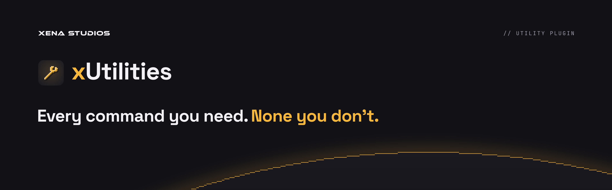
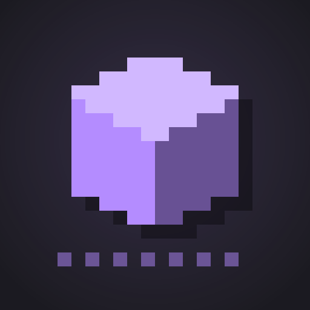

# Plugins

The small plugins share one family look, endorsed by XENA STUDIOS.

 &nbsp;  &nbsp;  &nbsp; 

## The system

- **Icon:** a 16×16 pixel glyph (Minecraft's item size) on a `raised` tile with a soft glow in the plugin's accent. Every glyph is lit the same way and stays crisp on Modrinth.
- **Name:** the first letter in the accent and the rest in `text`, set in Space Grotesk Bold. Keep the lowercase prefix: xUtilities, zChat, xLimbo.
- **Banner:** XENA STUDIOS, the `//` kicker, the icon and name, a two-tone headline, and the horizon with a pixel-stepped rim.
- **Accent:** one per plugin, and never one that another brand uses.

**Adding a plugin:** draw a 16×16 glyph and pick an unused accent in [`scripts/plugin-brand.ts`](../scripts/plugin-brand.ts), then rebuild. `pnpm build:plugins` rebuilds only the plugin family, and doesn't need Ethnocentric: the family draws XENA STUDIOS from the committed `logo/xena-studios.svg`.

## Lineup

| Plugin | Accent | Glyph | Headline |
|---|---|---|---|
| **xUtilities** | `#F5B83D` amber | Wrench | Every command you need. *None you don't.* |
| **zChat** | `#5EE08A` green | Chat bubble | Format your chat. *Keep it clean.* |
| **xLimbo** | `#B48CFF` violet | Block over a glass floor | Never drop *a player again.* |
| **xRewind** | `#3DD6C6` teal | Rewind button | Every change, logged. *Any of it, undone.* |
| **xPlots** (not released yet) | `#A9D750` lime, OKLCH hue 126 | Signpost | Rentable plots, *set up in a minute.* |
| **xTeleport** (not released yet) | `#EA87E2` orchid, OKLCH hue 330 | Pin over the ring it lands in | Every teleport *your server needs.* |
| **xVote** (not released yet) | `#91ACFF` periwinkle, OKLCH hue 272 | A ticked ballot over its box | Votes in. *Rewards out.* |
| **xBans** (not released yet) | `#FF9447` tangerine, OKLCH hue 54 | Gavel on its block | Bans, mutes and warnings, *the LiteBans way.* |

A plugin that's being built can be marked `released: false` in [`scripts/plugin-brand.ts`](../scripts/plugin-brand.ts): it gets its own icon, banner and social preview, but stays off the family's cards and horizon until its first release.

### Modrinth titles and summaries

Modrinth's search ranks a word in the title above everything else, so each title is the name and what the plugin is. The summary is the line under it in search results.

| Plugin | Title | Summary |
|---|---|---|
| **xUtilities** | xUtilities: Lightweight Essentials | Lightweight essentials for Paper and Folia: gamemode, fly, speed, heal, feed, /back, /top and repair, with anvils, crafting tables and other workstations anywhere. Add your own link commands like /discord, and switch off any command. |
| **zChat** | zChat: Chat Formatting & Filter | Chat formatting per rank, a chat filter that's hard to dodge, mentions, private messages, cooldowns and anti-spam, in one light chat plugin. Each message is drawn once, however many players see it. For Paper and Folia. |
| **xLimbo** | xLimbo: Limbo & Fallback Server | A limbo and fallback server for Velocity and BungeeCord. When your main server goes down, players wait in a safe void world instead of being kicked, then go back with /join, or on their own once it's up. For Paper. |
| **xRewind** | xRewind: Block Logger & Rollback | Block logger and rollback, and a free CoreProtect alternative: see who placed, broke or took what, then preview a rollback and undo it. Uses CoreProtect's commands and imports its history. For Paper and Folia. |
| **xPlots** | xPlots: Rentable Plots | Rentable plots for box and PvP servers: select an area and it's split into a grid of plots, each with its sign. Players rent with Vault or an item, add members and pay ahead; expired plots reset themselves. For Paper. |
| **xTeleport** | xTeleport: Homes, TPA, Warps & RTP | Homes, TPA, warps, spawn and random teleport in one light plugin, with warmups, cooldowns and costs through Vault. Imports homes and warps from EssentialsX, HuskHomes and CMI. For Paper and Folia. |
| **xVote** | xVote: Vote Rewards & Votifier | Vote rewards with a built-in Votifier for Paper and Folia: keeps NuVotifier's keys and tokens, rewards per site, streaks and every Nth vote, a vote party, leaderboards, and offline votes paid on join. Imports VotingPlugin and SuperbVote totals. |
| **xBans** | xBans: Bans, Mutes & Warnings | Bans, mutes, warnings and kicks with LiteBans' commands, flags and durations, free and open source. Checked from memory at every join and chat message, with templates, staff limits, alts and a LiteBans import. For Paper and Folia. |

## Colour

| Token | Hex | Role |
|---|---|---|
| `bg` | `#121116` | Banner background |
| `raised` | `#1B1A21` | Icon tile, planet body |
| `rule` | `#2A2832` | Borders |
| `text` | `#F2F0F5` | Names, headlines |
| `muted` | `#9C99A8` | Kickers, secondary text |

In [`tokens/plugins.css`](../tokens/plugins.css) (`--plugin-*`, plus `--plugin-<id>` for each accent) and [`tokens/plugins.json`](../tokens/plugins.json).

## Type

- **Space Grotesk** Bold for names and headlines.
- **JetBrains Mono** for kickers and labels.

## Files

| File | Size | Use |
|---|---|---|
| `plugins/<id>/icon` | 512×512 | Modrinth icon |
| `plugins/<id>/banner` | 1920×600 | Modrinth description and README banner |
| `plugins/<id>/social` | 1280×640 | GitHub social preview |
| `plugins/horizon` | 2400×900 | The family horizon alone: the docs home page |
| `social/docs-og` | 1200×630 | docs.xenastudios.co link preview |
