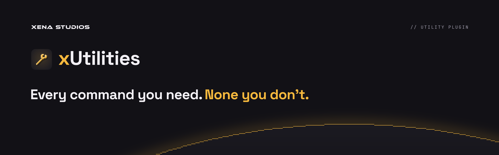
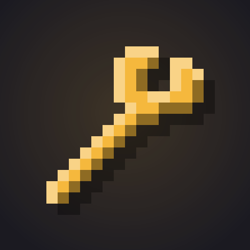
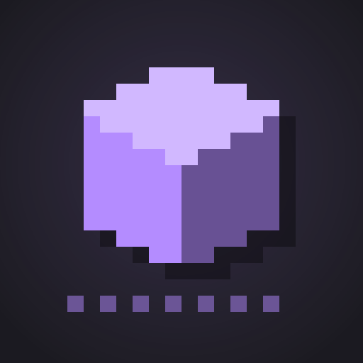

# Plugins

The small plugins share one family look, endorsed by XENA STUDIOS.

 &nbsp;  &nbsp; 

## The system

- **Icon:** a 16×16 pixel glyph (Minecraft's item size) on a `raised` tile with a soft glow in the plugin's accent. Every glyph is lit the same way and stays crisp on Modrinth.
- **Name:** the first letter in the accent and the rest in `text`, set in Space Grotesk Bold. Keep the lowercase prefix: xUtilities, zChat, xLimbo.
- **Banner:** XENA STUDIOS, the `//` kicker, the icon and name, a two-tone headline, and the horizon with a pixel-stepped rim.
- **Accent:** one per plugin, and never one that another brand uses.

**Adding a plugin:** draw a 16×16 glyph and pick an unused accent in [`scripts/plugin-brand.ts`](../scripts/plugin-brand.ts), then rebuild.

## Lineup

| Plugin | Accent | Glyph | Headline |
|---|---|---|---|
| **xUtilities** | `#F5B83D` amber | Wrench | Every command you need. *None you don't.* |
| **zChat** | `#5EE08A` green | Chat bubble | Format your chat. *Keep it clean.* |
| **xLimbo** | `#B48CFF` violet | Block over a glass floor | Never drop *a player again.* |

### Modrinth summaries

- **xUtilities:** Every command you need, none you don't: gamemodes, flight, heal, /back, workstation menus, and link commands like /discord that you write yourself. Every command can be switched off. For Paper and Folia.
- **zChat:** A chat format per rank, a filter that's hard to dodge, cooldowns, mentions and private messages. Each message is drawn once, however many players see it. For Paper and Folia.
- **xLimbo:** Your network's fallback server. When the main server goes down, players wait in a safe void world instead of being disconnected, then go back with /join, or on their own once it's up. For Paper.

## Colour

| Token | Hex | Role |
|---|---|---|
| `bg` | `#121116` | Banner background |
| `raised` | `#1B1A21` | Icon tile, planet body |
| `rule` | `#2A2832` | Borders |
| `text` | `#F2F0F5` | Names, headlines |
| `muted` | `#9C99A8` | Kickers, secondary text |

In [`tokens/plugins.css`](../tokens/plugins.css) (`--plugin-*`, plus `--plugin-<id>` for each accent) and [`tokens/plugins.json`](../tokens/plugins.json).

## Type

- **Space Grotesk** Bold for names and headlines.
- **JetBrains Mono** for kickers and labels.

## Files

| File | Size | Use |
|---|---|---|
| `plugins/<id>/icon` | 512×512 | Modrinth icon |
| `plugins/<id>/banner` | 1920×600 | Modrinth description and README banner |
| `plugins/<id>/social` | 1280×640 | GitHub social preview |
| `plugins/horizon` | 2400×900 | The family horizon alone: the docs home page |
| `social/docs-og` | 1200×630 | docs.xenastudios.co link preview |
