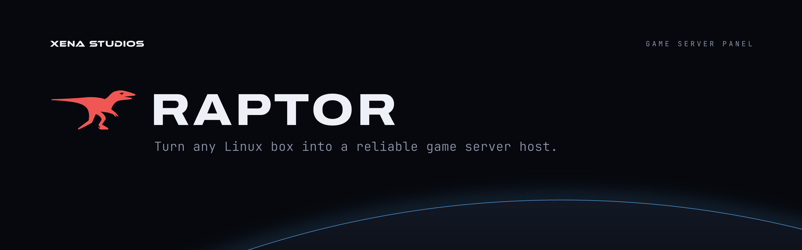

# Raptor

Signal Red on warm Ink ("The Console"). Raptor's identity comes from [its design doc](https://github.com/xena-studios/raptor/blob/main/docs/DESIGN.md); Xena only adds the horizon and the XENA STUDIOS endorsement.

## Marks

 &nbsp; 

- **Full logo:** the running raptor in Signal Red beside the **RAPTOR** wordmark. The two always appear together.
- **Small mark:** the R with a sickle-claw leg, in Signal Red. For spots 32px and up with no room for the full logo. Never next to the wordmark.
- **Icon:** the claw R in Ink on a Signal Red tile, for favicons, app icons and avatars.
- One flat colour per mark. The wordmark is Bone on dark and Graphite on light, and the red switches to Daylight on light.

## Colour

| Token | Hex | Role |
|---|---|---|
| `signal-red` | `#F05653` | The one accent: the raptor, marks, primary actions |
| `signal-red-daylight` | `#D01025` | Signal Red on light backgrounds |
| `on-signal` | `#1B0A09` | The claw R on the red tile |
| `ink` | `#0F0808` | Background |
| `ink-raised` | `#181110` | Cards, planet body |
| `ink-rule` | `#342C2B` | Borders |
| `bone` | `#F5F0F0` | Text on dark |
| `ash` | `#9F9695` | Secondary text, kickers |
| `graphite` | `#190F0E` | Text on light |

The full set, with Daylight and state colours, is in [`tokens/raptor.css`](../tokens/raptor.css) and [`tokens/raptor.json`](../tokens/raptor.json). Red means the action or what's live, never decoration.

## Type

- **Hanken Grotesk** for sentences: Bold headlines, Regular body.
- **JetBrains Mono** for anything a machine says and every control: labels, buttons, numbers, the `//` kicker.
- **Archivo** ExtraBold is only used for the wordmark.

## Files

| File | Use |
|---|---|
| `raptor/banner` | README banner (1920×600) |
| `raptor/logo-dark`, `raptor/logo-light` | Full logo for dark and light backgrounds |
| `raptor/icon` | Favicon, app icon, avatar (512) |
| `raptor/mark` | The small claw R |
| `raptor/official/` | Copied from the Raptor repo: docs logos, favicon, link preview |

The marks and colours are copied into [`scripts/raptor-brand.ts`](../scripts/raptor-brand.ts) from Raptor's repo. If Raptor's change, update that file, refresh `raptor/official/`, and rebuild.
