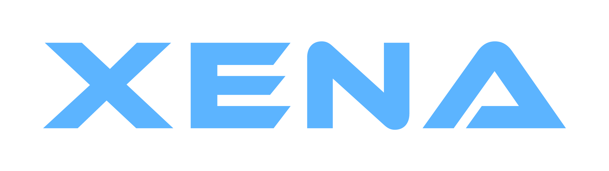
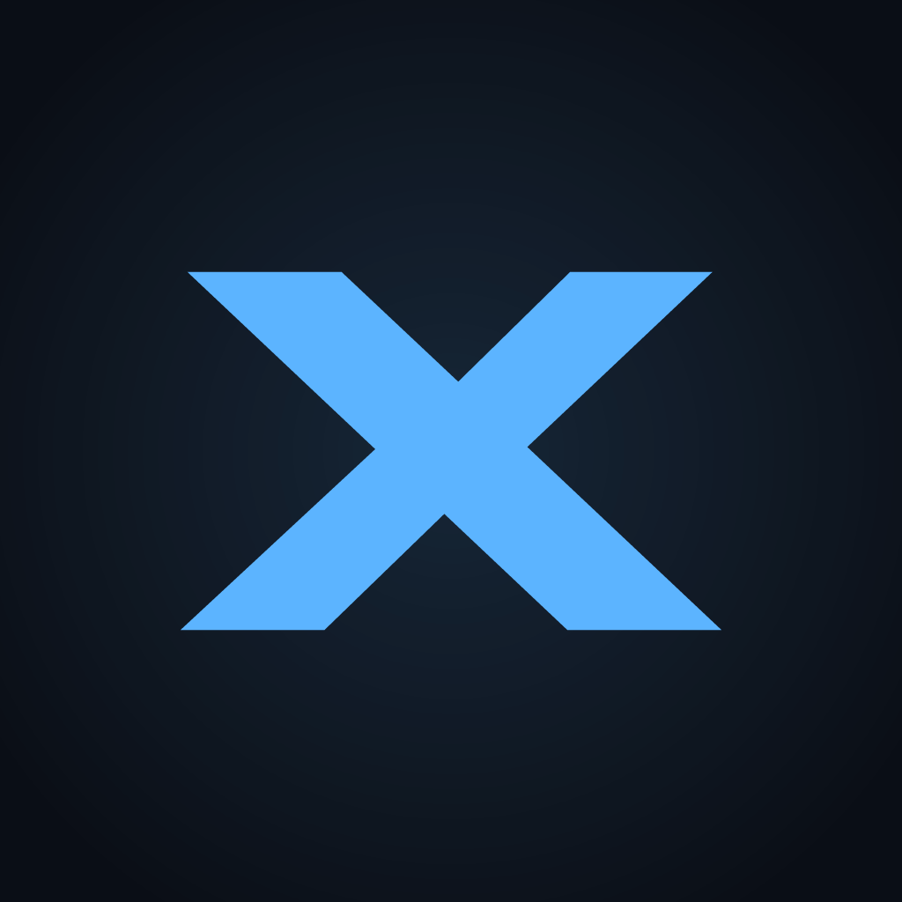
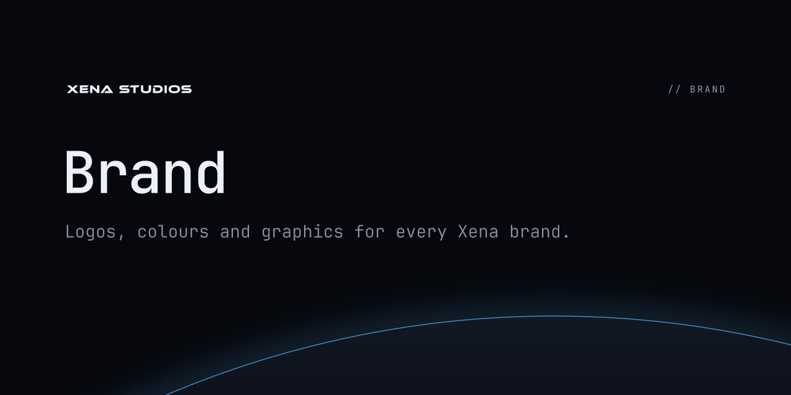
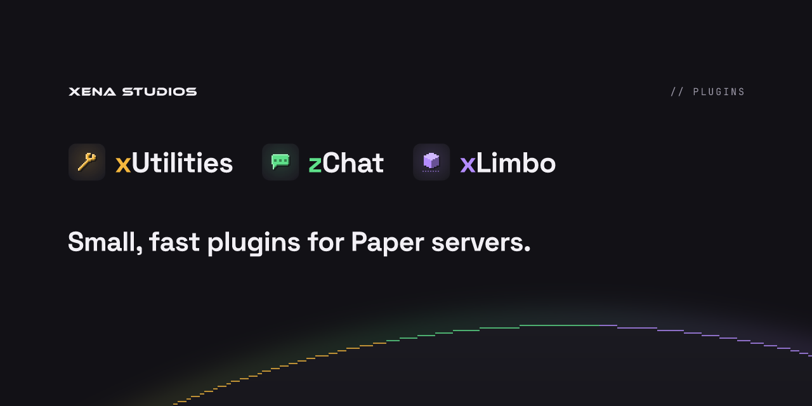

# Xena Studios

Type only, Ion Blue on deep space.

## Logo

The logo is the Ethnocentric type itself, with no symbol. Use the widest version that fits.

| Version | Use | Files |
|---|---|---|
| **XENA STUDIOS** | Primary: site header, banners, the endorsement on product graphics | `logo/xena-studios*.svg` |
| **XENA** | Tight spaces, footers, merch | `logo/xena*.svg` |
| **X** | Avatar, favicon, app icon | `logo/x*.svg`, `avatar/` |

Each comes in four colours: default (`text`), `-blue`, `-white` and `-black`, as SVG and PNG.

 &nbsp;  &nbsp; 

- **Clear space:** half the cap height on every side. The exported files include it.
- **Minimum width:** XENA STUDIOS 120px, XENA 64px, X 16px.
- **Backgrounds:** blue only on `void` or `space`. On light or photo backgrounds, use white or black.
- **Don't** add a symbol, stars, outlines, gradients or a second accent, and don't set Ethnocentric in lowercase or as live web text.

## Colour

Ion Blue is the only accent. Everything else is neutral.

| Token | Hex | Role |
|---|---|---|
| `void` | `#06080D` | Page background |
| `space` | `#0A0E16` | Tiles, avatar |
| `surface` | `#121824` | Raised panels, planet body |
| `line` | `#222B3B` | Borders |
| `muted` | `#8A93A6` | Secondary text |
| `text` | `#EDF1F7` | Text, logo |
| `accent` | `#5CB4FF` | Ion Blue: the X, the horizon glow |

In [`tokens/colors.css`](../tokens/colors.css) (`--xena-*`) and [`tokens/colors.json`](../tokens/colors.json).

## Type

| Role | Face |
|---|---|
| Logo | **Ethnocentric**: caps only, always outlined |
| Taglines and labels | **JetBrains Mono**: Light for taglines, Regular for labels, SemiBold for repo-card titles |

JetBrains Mono is the one face every brand shares. The uppercase `//` kicker on every banner is set in it.

**About Ethnocentric:** the free Typodermic licence only covers logos and outlined images. That's why the font isn't in this repo and every letter is a vector path. Buy a webfont licence before using it as live text anywhere.

## Horizon

Every Xena graphic uses the same scene: a flat sky and one huge planet arcing across the bottom. Nothing else, and no stars. Products draw it in their own colours, the plugins step its rim into pixels, and MostWanted uses its pixel desert instead.

| File | Size | Use |
|---|---|---|
| `social/x-header` | 1500×500 | X / Twitter header, GitHub profile header |
| `social/discord-banner` | 960×540 | Discord server banner |
| `social/og-card` | 1200×630 | xenastudios.co link preview |
| `avatar/avatar` | 512×512 | GitHub, Modrinth and social avatars |
| `avatar/favicon` | 64×64 | Favicon |
| `avatar/apple-touch-icon` | 180×180 | iOS home-screen icon |
| `scene/horizon` | 2400×900 | The horizon alone: site and slide backgrounds |

PNGs are exported at 2× unless noted.

## Repo cards

 &nbsp; 

Every repo gets a 1280×640 GitHub social preview in the same layout: XENA STUDIOS top-left, a `//` kicker top-right, the title, and the horizon.

- `brand`, `website` and `.github` use the studio's look: `github/<repo>.png`.
- `plugins` shows all three plugins.
- NeoSkript and MostWanted use their own: `neoskript/social`, `mostwanted/social`.
- Raptor makes its own in its repo.

Upload them in each repo under **Settings → General → Social preview**. GitHub has no API for this.

## Team photos

Profile photos for Google, GitHub and Discord: the person's initial in Ion Blue on a `space` tile. To add someone, add them to `people` in `scripts/build.ts` and rebuild.

| File | Person |
|---|---|
| [`people/zachary.png`](../people/zachary.png) | Zachary, Founder |

## Google Workspace

Upload [`workspace/logo.png`](../workspace/logo.png) in the Admin console under **Account → Account settings → Personalization → Logo**. It can take up to 3 days to show in Gmail.

It's the short **XENA** in black on transparent: Google frames logos in white, and XENA STUDIOS is unreadable at Gmail's size.
